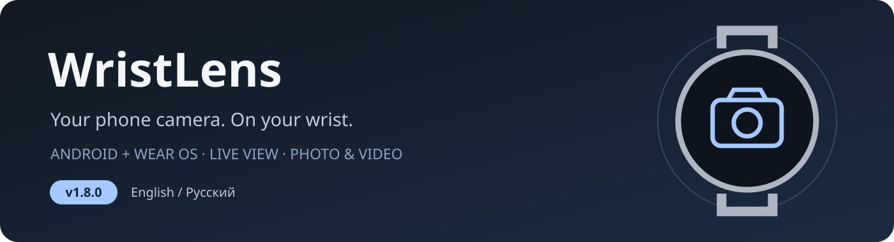

<p align="center"></p>

<p align="center"><strong>English</strong> · <a href="README_RU.md">Русский</a></p>
<p align="center"><a href="https://github.com/S0nicRunn3rX/WristLens/releases/tag/v1.8.0">Download 1.8.0</a> · <a href="CHANGELOG.md">Changelog</a> · <a href="docs/INSTALL_EN.md">User guide</a> · <a href="RELEASES.md">Version archive</a></p>

# WristLens

Control your **Android phone camera from a Wear OS watch**, with a live view on your wrist. WristLens pairs a phone app with a watch app and uses the phone's public camera capabilities. It was developed for an Infinix X678B and Samsung Galaxy Watch Ultra 2025, without requiring a Samsung or Pixel phone.

## What you can do

| Camera & capture | Watch experience |
|---|---|
| Photos, video, pause/resume and photos during video | Live preview across the round display |
| Hold the shutter for a burst of up to 50 frames | Pinch to fit/zoom the preview, drag to pan, double-tap to reset |
| Separate photo/video timers; flash and torch | Quick icons; long-press for flash, timer and camera settings |
| Front/rear cameras; focus, exposure point and camera zoom | Bezel/rotary navigation and precise slider adjustments |
| Available resolution, aspect ratio, frame rate and codecs | List/grid gallery, file count, multiple selection and sharing |
| Date/time watermarks on saved photos and videos | Original or compressed copies, automatic saving and download progress |
| Independent recording audio and live microphone monitoring | Optional haptics, capture sounds and shutter animation |

## Install and connect

1. Download **both** APKs from [release 1.8.0](https://github.com/S0nicRunn3rX/WristLens/releases/tag/v1.8.0): `WristLens-phone-1.8.0-release.apk` and `WristLens-wear-1.8.0-release.apk`.
2. Install the phone APK on Android **10+** and the watch APK on a Wear OS device with Android API **30+**. The devices must be paired and have Google Play services. The watch app is not a standalone camera.
3. Open the phone app once and grant camera permission; grant microphone permission for audio. Then open WristLens on the watch. It requests the phone app and a camera session automatically; Android may still require unlocking or permission confirmation.
4. Update both devices together. Published APKs retain the project's existing signing identity. See [installation, ADB commands and troubleshooting](docs/INSTALL_EN.md).

English is the default language. A device whose primary system language is Russian uses Russian independently of the other device.

## Everyday controls

| Action | Control |
|---|---|
| Take a photo / start video | Centre button in the selected mode |
| Burst | Hold the photo button; release to stop |
| Pause / resume video | Bottom-left button during recording |
| Stop video | Bottom-right button during recording |
| Photo during video | Centre button while recording |
| Mute / unmute the current recording | Top-right microphone icon during recording, including pause |
| Focus / exposure point | Tap the image, when supported by the camera |
| Change actual camera zoom | Bezel / rotary input or camera settings |
| Fit, magnify or move only the watch view | Pinch / drag; double-tap the image to reset |

**Preview scaling is independent of camera zoom.** Fitting the picture into the circular screen adds black margins but does not change saved media. Air-pinch gesture recognition was removed in 1.4.0; 1.8.0 gestures are touches on the display.

## Sensible defaults

- Originals: `DCIM/Camera`, `IMG_YYYYMMDD_HHMMSS.jpg` / `VID_YYYYMMDD_HHMMSS.mp4`. Folder, name pattern and supported file types are configurable.
- Camera mode: largest available frame area, then highest FPS at that size. Lower-resolution high-FPS modes can be chosen manually.
- Burst: **50 frames**, **200 ms after each saved frame**, with a 60-second safety limit. Processing and exposure add time.
- Recording audio on; live audio monitoring off. Background capture on; automatic watch copies off. Watch copies use original quality and `DCIM/Camera` by default.
- The camera session disconnects after 60 seconds of watch background inactivity when no capture is active. Recording, pauses, timers and pending photos are protected. File-copy jobs are independent.

## Build from source

Java 17 · Android SDK 36 · Gradle wrapper · Android Gradle Plugin 8.13.2.

```sh
chmod +x gradlew
./gradlew :phone:assembleDebug :wear:assembleDebug
./gradlew :core:test :phone:testDebugUnitTest :wear:testDebugUnitTest
```

Modules: `core` (protocol and policies), `shared` (UI and transport), `phone` (camera and media), `wear` (watch controls, gallery and downloads).

The public source export excludes private signing material. Debug uses the standard local debug key; release builds need your own matching signing configuration for both apps. [Build and signing guide](docs/BUILD.md). Historical APKs remain unchanged. Self-built APKs with a different certificate cannot update those installations in place.

## History, verification and limitations

[Version archive](RELEASES.md) tracks the debug line **0.1.0 → 0.2.0 → watch-only 0.2.1** and releases **1.0.0–1.8.0**. [English changelog](CHANGELOG.md) and [Russian changelog](CHANGELOG_RU.md) link to a separate bilingual entry for every version and the original reports. Availability of historical binaries/source snapshots is recorded explicitly in the archive.

The original 1.8.0 build report records **179 passing JUnit/Robolectric tests** and **zero Android Lint errors**, with remaining warnings documented. This is historical build evidence, not a new hardware test of this public export. [Full 1.8.0 report](docs/RELEASE_1.8_RU.md).

Camera features depend on Camera2/HAL and encoder support exposed by the phone. Marketing sensor resolutions and FPS may not be available to third-party apps. Preview FPS depends on the connection. Watermarks do not support constrained high-speed capture. Some video snapshots use the preview and have lower quality. Real camera capture, Bluetooth/Wi-Fi performance and OEM background behaviour still require testing on the physical devices.

## Privacy and license

WristLens uses the paired-device Wear OS data layer for commands, preview and transfers. Camera and microphone access require phone permissions; media stays on your devices unless you choose to share it. Diagnostic exports should be reviewed before posting.

[MIT license](LICENSE) · Project by [S0nicRunn3rX](https://github.com/S0nicRunn3rX). Developed with assistance from OpenAI Codex.
